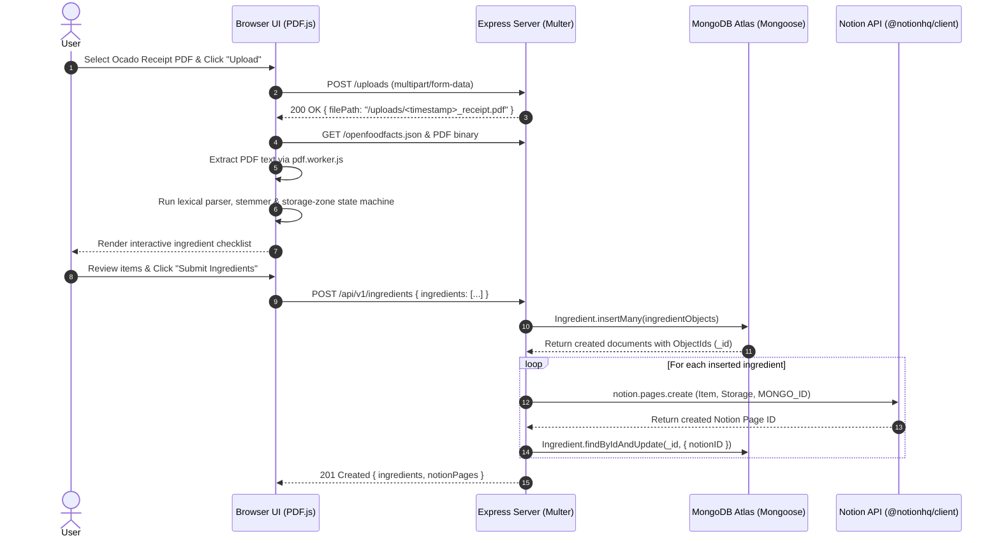

# Ocado Helper — Automated Grocery Receipt Parser & Notion Inventory Pipeline

**Ocado Helper** is a full-stack Node.js application that automates household kitchen inventory management. It ingests unstructured PDF grocery receipts from Ocado, extracts and classifies food items alongside their storage locations (`Fridge`, `Cupboard`, `Frozen`) using client-side PDF parsing and lexical heuristics, persists records in **MongoDB Atlas**, and automatically populates a **Notion** database for meal planning and stock tracking.

---

## Table of Contents

- [Project Overview & Motivation](#project-overview--motivation)
- [System Architecture & End-to-End Pipeline](#system-architecture--end-to-end-pipeline)
- [Technologies Used](#technologies-used)
- [Key Code Highlights](#key-code-highlights)
  - [1. Context-Aware Receipt Tokenizer & Heuristic Parser](#1-context-aware-receipt-tokenizer--heuristic-parser)
  - [2. Cross-Database Synchronization (MongoDB ↔ Notion)](#2-cross-database-synchronization-mongodb--notion)
  - [3. Higher-Order Async Error Wrapper](#3-higher-order-async-error-wrapper)
- [What I Learned & Engineering Challenges](#what-i-learned--engineering-challenges)
- [API Reference](#api-reference)
- [Project Structure](#project-structure)
- [Getting Started (Local Development)](#getting-started-local-development)

---

## Project Overview & Motivation

Tracking kitchen inventory manually after every grocery delivery is tedious, which leads to forgotten ingredients and food waste. While online supermarkets provide PDF receipts, those receipts are designed for human reading rather than machine ingestion—they contain delivery instructions, pricing columns, promotions, legal boilerplate, and multi-word product names (e.g., *"Ocado British Chicken Breast Fillets"*).

**Ocado Helper** bridges the gap between raw PDF receipts and a structured Notion workspace:
1. **Extracts raw text** from uploaded Ocado receipt PDFs in the browser using Mozilla's `PDF.js`.
2. **Infers storage zones** (`Fridge`, `Cupboard`, `Frozen`) by tracking receipt section headers as a state machine.
3. **Filters noise and reconstructs food names** by cross-referencing receipt tokens against a 2.4 MB **OpenFoodFacts** ingredient taxonomy, handling plural morphology and compound food names.
4. **Provides a human-in-the-loop verification step** so users can review and toggle detected ingredients before committing.
5. **Synchronizes state across MongoDB and Notion**, maintaining bidirectional foreign-key references (`MONGO_ID` ↔ `notionID`) between both systems.

---

## System Architecture & End-to-End Pipeline



### The 5-Stage Pipeline

1. **Stage 1 — Multipart File Ingestion (`POST /uploads`)**:
   The client submits the receipt PDF using `FormData`. Express processes the upload stream via **Multer** disk storage middleware, stamping the filename with a Unix timestamp (`Date.now()`) to prevent collisions, and serves the file path back to the client.
2. **Stage 2 — Client-Side Binary Text Extraction (`PDF.js`)**:
   Using a dedicated Web Worker (`pdf.worker.js`), the browser loads the uploaded PDF document off the main thread, iterates through the PDF's text layer items (`page.getTextContent()`), and flattens the spatial text blocks into a sequential token stream.
3. **Stage 3 — Lexical Heuristics & Taxonomy Matching**:
   The raw text stream is passed through `cleanText()`, which tracks the current storage category (`Fridge`, `Cupboard`, `Freezer`), strips plural suffixes (`-S`, `-ES`), pairs modifier tokens into compound nouns (e.g., `SALAD ONIONS`, `CHICKEN WINGS`), and validates candidate tokens against the **OpenFoodFacts** tag corpus (`openfoodfacts.json`).
4. **Stage 4 — Human-in-the-Loop Selection**:
   Deduplicated ingredients are dynamically rendered as HTML checkboxes with their inferred storage location bound to `data-location` attributes (`dataset.location`).
5. **Stage 5 — Dual-Write Persistence & Cross-Linking (`POST /api/v1/ingredients`)**:
   Checked items are sent to the Express backend, validated and normalized, batch-inserted into **MongoDB Atlas**, and then written to **Notion** via the official `@notionhq/client` SDK. Each Notion page stores the MongoDB `_id`, and each MongoDB document is updated with the resulting `notionID`.

---

## Technologies Used

| Category | Technology | Role in Project |
| :--- | :--- | :--- |
| **Backend Runtime** | **Node.js (v18+)** | Server-side JavaScript execution environment |
| **Web Framework** | **Express.js** | REST API routing, static asset serving, and centralized error handling |
| **Database & ODM** | **MongoDB Atlas & Mongoose** | Cloud document store and schema validation for ingredient records |
| **External Integration** | **Notion SDK (`@notionhq/client`)** | Programmatic creation and querying of Notion database pages |
| **File Handling** | **Multer** | `multipart/form-data` middleware for ingesting uploaded PDF receipts |
| **PDF Parsing** | **Mozilla PDF.js (`pdfjs-dist`)** | Client-side PDF binary rendering and asynchronous text layer extraction |
| **Data & NLP Corpus** | **OpenFoodFacts & PapaParse** | 2.4 MB food taxonomy dataset & CSV parsing utilities for ingredient recognition |
| **Frontend / HTTP** | **Vanilla JS (ES6+), Axios, HTML5/CSS3** | Lightweight DOM manipulation, asynchronous HTTP requests, and responsive UI |

---

## Key Code Highlights

### 1. Context-Aware Receipt Tokenizer & Heuristic Parser

Ocado receipts group items under storage headings (*Fridge*, *Cupboard*, *Freezer*) and print product names in uppercase for emphasis. In [`public/script.js`](public/script.js), `cleanText()` acts as both a **state machine** (updating `storageLocation` whenever it encounters a section header) and a **heuristic parser** that reconstructs two-word food compounds (`adjectiveFoods` like *"SALAD ONIONS"* and `prefixFoods` like *"CHICKEN BREAST"*) while handling plural stemming:

```javascript
// public/script.js
function cleanText(pdfText, openFoodDatabase) {
    let storageLocation = 'Missing';
    const wordObjectArray = [];
    const finalIngredients = [];
    const blockedItems = new Set();
    const splitPdfText = pdfText.split(' ');

    const fridgeRegex = /Fridge/;
    const cupboardRegex = /Cupboard/;
    const freezerRegex = /Freezer/;
    const missingRegex = /Missing/;
    const pluralEs = /(ES|S)$/;
    const pluralS = /S$/;
    const capitalRegex = /^[A-Z]+$/;

    // Pass 1: Tag every token with the active storage section state
    for (const word of splitPdfText) {
        if (fridgeRegex.test(word)) storageLocation = 'Fridge';
        if (cupboardRegex.test(word)) storageLocation = 'Cupboard';
        if (freezerRegex.test(word)) storageLocation = 'Frozen';
        if (missingRegex.test(word)) storageLocation = 'Missing';
        wordObjectArray.push({ name: word, location: storageLocation });
    }

    // Pass 2: Reconstruct compound foods, stem plurals, and validate against OpenFoodFacts
    for (let index = 0; index < wordObjectArray.length; index += 1) {
        const wordObject = wordObjectArray[index];
        const word = wordObject.name;
        const previous = wordObjectArray[index - 1];
        const next = wordObjectArray[index + 1];

        if (blockedItems.has(word)) continue;

        if (adjectiveFoods.includes(word) && previous) {
            finalIngredients.push({
                name: `${previous.name} ${word}`,
                location: wordObject.location
            });
            blockedItems.add(previous.name);
        } else if (prefixFoods.includes(word) && next) {
            finalIngredients.push({
                name: `${word} ${next.name}`,
                location: wordObject.location
            });
        } else if (isFoodItem(word, openFoodDatabase) && capitalRegex.test(word)) {
            finalIngredients.push(wordObject);
            blockedItems.add(word);
        } else {
            const singularNoS = pluralS.test(word) ? word.slice(0, -1) : word;
            const singularNoEs = word.match(pluralEs) ? word.replace(pluralEs, '') : word;

            if (isFoodItem(singularNoS, openFoodDatabase) && capitalRegex.test(word)) {
                finalIngredients.push(wordObject);
                blockedItems.add(word);
            } else if (isFoodItem(singularNoEs, openFoodDatabase) && capitalRegex.test(word)) {
                finalIngredients.push(wordObject);
                blockedItems.add(word);
            }
        }
    }

    return removeRedundancies(finalIngredients);
}
```

---

### 2. Cross-Database Synchronization (MongoDB ↔ Notion)

When a user submits selected ingredients, the backend ensures data consistency across MongoDB and Notion. First, [`controllers/ingredients.js`](controllers/ingredients.js) validates and batch-inserts the documents into MongoDB so each item receives a unique `_id`. Next, [`controllers/notionService.js`](controllers/notionService.js) creates the corresponding Notion database pages with the MongoDB `_id` embedded as rich text, and writes the newly generated Notion page ID back to the MongoDB document:

```javascript
// controllers/ingredients.js
const addIngredients = asyncWrapper(async (req, res) => {
    const ingredients = req.body?.ingredients;
    if (!Array.isArray(ingredients) || ingredients.length === 0) {
        return res.status(400).json({ msg: 'Provide at least one ingredient' });
    }

    const ingredientObjects = ingredients.map((ingredient) => ({
        name: String(ingredient.name || '').trim(),
        location: normalizeLocation(ingredient.location)
    }));

    if (ingredientObjects.some((ingredient) => !ingredient.name)) {
        return res.status(400).json({ msg: 'Each ingredient needs a name' });
    }

    const insertedIngredients = await Ingredient.insertMany(ingredientObjects);
    const notionPages = await createNotionPages(insertedIngredients);

    res.status(201).json({ ingredients: insertedIngredients, notionPages });
});
```

```javascript
// controllers/notionService.js
const createNotionPages = async (ingredients) => {
    assertNotionConfiguration();

    const createdRows = [];
    for (const ingredient of ingredients) {
        const notionData = await notion.pages.create({
            parent: {
                type: 'database_id',
                database_id: process.env.NOTION_DATABASE_ID
            },
            properties: {
                Item: {
                    title: [{ type: 'text', text: { content: ingredient.name } }]
                },
                Storage: {
                    multi_select: [{ name: normalizeStorageLocation(ingredient.location) }]
                },
                MONGO_ID: {
                    rich_text: [{ type: 'text', text: { content: ingredient._id.toString() } }]
                }
            }
        });

        await Ingredient.findByIdAndUpdate(ingredient._id, { notionID: notionData.id });
        createdRows.push(notionData);
    }

    return createdRows;
};
```

---

### 3. Higher-Order Async Error Wrapper

To keep Express route controllers clean and declarative without repetitive `try / catch` blocks in every handler, [`middleware/async.js`](middleware/async.js) implements a functional higher-order wrapper that catches rejected promises and forwards them to Express's error-handling middleware:

```javascript
// middleware/async.js
const asyncWrapper = (fn) => {
    return async (req, res, next) => {
        try {
            await fn(req, res, next);
        } catch (error) {
            next(error);
        }
    };
};

module.exports = asyncWrapper;
```

---

## What I Learned & Engineering Challenges

Building **Ocado Helper** involved solving several practical full-stack and data-engineering challenges:

### 1. Parsing Unstructured PDF Text Streams
Unlike HTML or JSON, PDFs do not encode semantic tables or hierarchical lists—they only store positioned glyph runs on a coordinate canvas. Using **Mozilla's `PDF.js`**, I learned how to work with asynchronous Web Workers (`pdf.worker.js`) to extract raw text streams without blocking the browser's main UI thread, and how to design a sequential state machine that infers item attributes (like storage location) from positional section headers (`Fridge`, `Cupboard`, `Freezer`).

### 2. Lexical Heuristics, Stemming, and False-Positive Filtering
A raw receipt contains hundreds of non-food words (addresses, order numbers, weights, prices, delivery vans, promotional text). Cross-referencing single tokens against the **OpenFoodFacts** taxonomy initially missed pluralized nouns (e.g., `ONIONS`, `TOMATOES`) and split compound ingredients into generic words (e.g., `SALAD ONIONS` becoming just `ONIONS`, or `CHICKEN BREAST` losing its modifier).
* **Solution**: I implemented rule-based suffix stemming (`/(ES|S)$/`), lookbehind/lookahead token pairing (`previous` and `next` pointers in the token stream), and a deduplication set (`seen` keys combining `name|location`) to reconstruct multi-word ingredients accurately while keeping false positives out.

### 3. Cross-System Data Integrity & Safe Synchronization
Synchronizing state between an application database (**MongoDB**) and a third-party workspace API (**Notion**) taught me important lessons about distributed data integrity:
* **Bidirectional Linking**: By inserting into MongoDB first, passing the resulting `_id` into Notion's `MONGO_ID` property, and then updating the MongoDB record with Notion's `page.id` (`notionID`), both databases retain an explicit foreign-key link for future updates or deletions.
* **Guarding Against Partial-Read Data Loss**: Third-party APIs like Notion paginate query responses (returning at most 100 items per request by default). Early iterations of a two-way `/sync` endpoint compared MongoDB rows against a single unpaginated Notion query and deleted rows that didn't appear—which risked wiping valid database records once the Notion table grew. Recognizing this failure mode led to isolating the write pipeline and disabling destructive sync until cursor-based pagination is used.

### 4. Multipart Binary Uploads & Environment Portability
Configuring **Multer** disk storage taught me how multipart streams are buffered and written on the server. Furthermore, refactoring hardcoded `localhost` URLs to relative paths and binding Express to `process.env.PORT || 3001` demonstrated how a unified Express process can seamlessly serve both static frontend assets and REST API routes across local and cloud (PaaS) environments.

---

## API Reference

| Method | Endpoint | Description |
| :--- | :--- | :--- |
| `POST` | `/uploads` | Uploads a receipt PDF (`multipart/form-data`, field `pdf`) and returns `{ filePath }`. |
| `GET` | `/api/v1/ingredients` | Retrieves all stored ingredient documents from MongoDB. |
| `POST` | `/api/v1/ingredients` | Batch-inserts selected ingredients into MongoDB and creates corresponding Notion pages. |
| `PATCH` | `/api/v1/ingredients/:id` | Updates a specific ingredient document in MongoDB by `_id`. |
| `DELETE` | `/api/v1/ingredients/:id` | Deletes a specific ingredient document from MongoDB by `_id`. |
| `GET` | `/api/v1/notion/database` | Retrieves metadata and schema properties for the configured Notion database. |
| `POST` | `/api/v1/notion/getIds` | Queries the Notion database to inspect existing page records. |

---

## Project Structure

```text
ocado-helper/
├── app.js                      # Express application entry point & server bootstrap
├── parseDatabase.js            # Utility script for exploring CSV/JSON food datasets
├── controllers/
│   ├── ingredients.js          # CRUD controllers for MongoDB ingredients + Notion trigger
│   └── notionService.js        # Notion SDK client & page creation logic
├── database/
│   ├── mongoConnect.js         # Mongoose connection wrapper
│   ├── ingredients.csv         # Raw ingredient taxonomy CSV dataset
│   └── foundationDownload.json # USDA Foundation Foods dataset
├── middleware/
│   ├── async.js                # Higher-order async/await error handling wrapper
│   └── upload.js               # Multer diskStorage configuration for PDF uploads
├── models/
│   └── Ingredient.js           # Mongoose schema (name, location, notionID)
├── public/
│   ├── index.html              # Frontend UI
│   ├── script.js               # PDF.js extraction, heuristic parser, and API client
│   ├── style.css               # Application styling
│   ├── openfoodfacts.json      # OpenFoodFacts tag dictionary used by the browser parser
│   ├── pdf.js / pdf.worker.js  # Mozilla PDF.js build and Web Worker
│   └── receipt.pdf             # Sample Ocado receipt for end-to-end testing
├── routes/
│   ├── ingredients.js          # Express router for /api/v1/ingredients
│   └── notionRoutes.js         # Express router for /api/v1/notion
└── uploads/                    # Runtime directory for uploaded PDFs (git-ignored)
```

---

## Getting Started (Local Development)

### 1. Prerequisites
* **Node.js** v18 or later
* A **MongoDB** instance (MongoDB Atlas free tier cluster or local MongoDB)
* A **Notion Integration Token** and target **Notion Database**

### 2. Configure Your Notion Database
Create a database in Notion, share it with your Notion integration, and ensure it has the following properties:
* **`Item`** — `Title`
* **`Storage`** — `Multi-select` (e.g., `Fridge`, `Cupboard`, `Frozen`, `Missing`)
* **`MONGO_ID`** — `Text` (`Rich text`)

### 3. Install Dependencies
```bash
npm ci
```

### 4. Set Environment Variables
Copy `.env.example` to `.env` and populate your credentials:
```bash
cp .env.example .env
```
```env
MONGO_URI=mongodb+srv://<user>:<password>@<cluster>.mongodb.net/?retryWrites=true&w=majority
NOTION_API_KEY=secret_your_notion_integration_token
NOTION_DATABASE_ID=your_notion_database_id
```

### 5. Run the Application
```bash
# Start the server
npm start

# Or run in watch mode during development
npm run dev

# Run syntax verification checks
npm run check
```

### 6. Test the Full Pipeline
1. Open [`http://localhost:3001`](http://localhost:3001) in your browser.
2. Click **Choose File** and select one of the included sample receipts (`public/receipt.pdf` or `public/receipt-3333162999.pdf`).
3. Click **Upload** to parse the PDF and generate the categorized ingredient checklist.
4. Check the items you want to track and click **Submit Ingredients**.
5. Verify the newly created entries in your **Notion database** and at [`http://localhost:3001/api/v1/ingredients`](http://localhost:3001/api/v1/ingredients).
